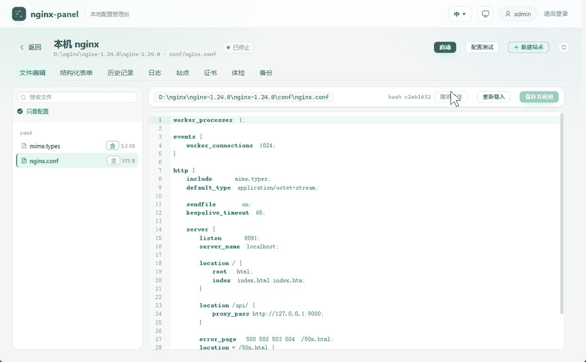
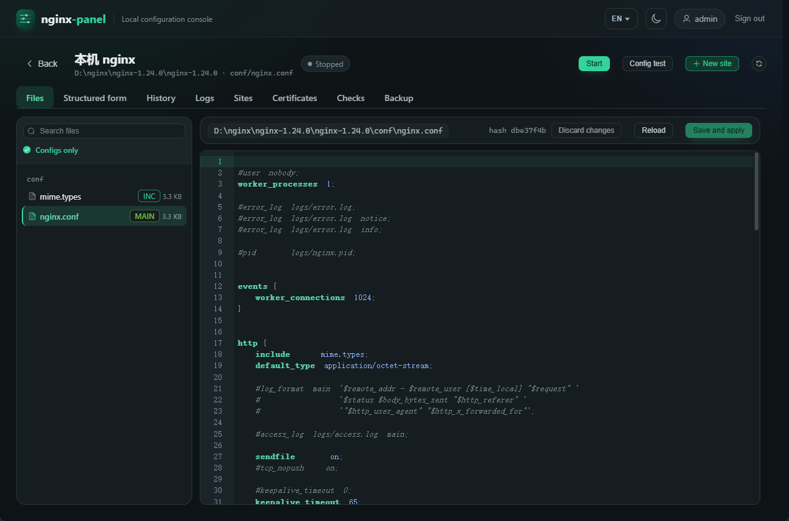
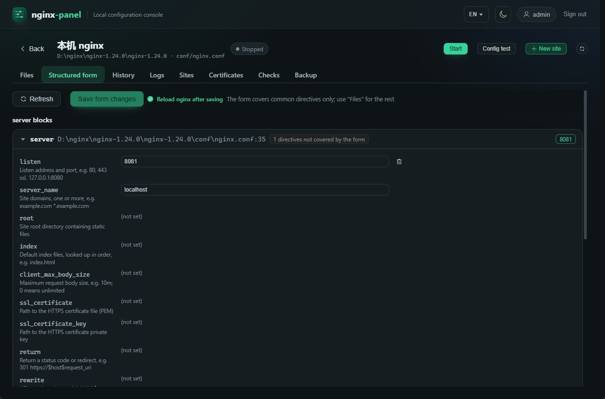
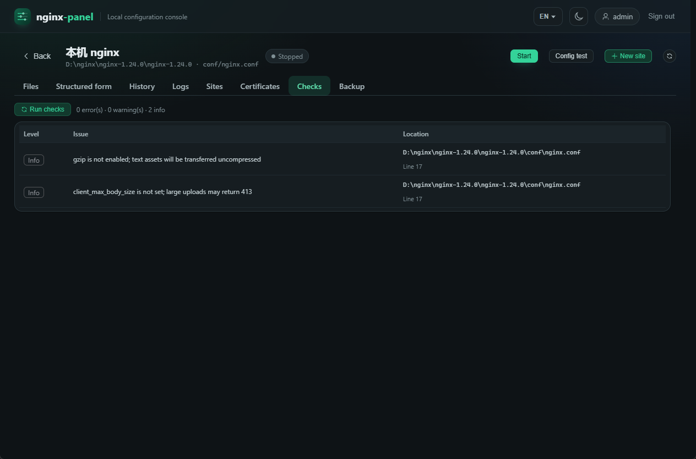

# nginx-panel

[English](README.md) | [简体中文](README.zh-CN.md)

[](https://github.com/coffin03/nginx-panel/actions/workflows/ci.yml)


A local-first web UI for nginx: edit the real configuration tree, validate every change with `nginx -t`, reload, and roll back automatically if anything breaks. No cloud, no telemetry.

> If this project saves your nginx config once, consider giving it a star — it helps others find it.



## Why another nginx panel?

nginx-panel is for people who manage the actual `nginx.conf` and its `include` tree, not only a list of proxy hosts.

| Project | Best for | Arbitrary config editing | Applies to a live nginx |
| --- | --- | --- | --- |
| **nginx-panel** | Full nginx config management with a safe apply pipeline | Yes, with `include` expansion | Yes, with test / reload / rollback |
| [Nginx Proxy Manager](https://github.com/NginxProxyManager/nginx-proxy-manager) | Reverse proxy hosts with a simple UI | Partial (per-host snippets) | Yes |
| [NginxConfig.io](https://github.com/digitalocean/nginxconfig.io) | Generating a new nginx config | Generates a config | No |
| [nginx-ui](https://github.com/0xJacky/nginx-ui) | General nginx management UI | Yes | Yes |

Comparison reflects each project's public documentation at the time of writing; corrections are welcome via PR.

## Features

- **Edit the real config tree.** `include` directives are expanded recursively, every loaded file is editable, and the bundled editor keeps syntax highlighting, indentation and comments intact.
- **Structured forms with minimal diffs.** Manage common `server` / `location` / `upstream` directives visually. Only the changed fragment is rewritten, so formatting and comments survive.
- **Safe apply pipeline.** Snapshot → write → `nginx -t` → reload → health check. Any failure restores the previous state automatically, including a new `[emerg]` in `error.log`.
- **Site wizard and site management.** Generate `conf.d` sites for static files or reverse proxies, mount the `include` automatically, then enable, disable, edit or delete them.
- **Certificates.** Scan referenced certificates for domains, issuer and expiry; renew with a detected `certbot` / `acme.sh` command and verify the certificate actually changed.
- **Config checks.** AST-based inspection for duplicate `server_name`, outdated TLS protocols, broken certificate paths, missing web roots, unmounted `conf.d` and common hardening items.
- **Backup and restore.** Export the main config and its include chain as a zip. Import previews new / overwritten / unchanged files and still runs through validation and rollback.
- **History, logs and operations.** Every apply creates a snapshot with a line diff and one-click restore; external edits are captured automatically. Logs support auto-refresh and keyword filtering.
- **Local-first and bilingual.** SQLite (WAL) + bcrypt, first-run admin setup, Chinese / English UI, no network calls.

## Quick start

### Windows (portable)

No Python or Node.js required.

1. Open [Releases](../../releases/latest) and download `nginx-panel-<version>-win64.zip`.
2. Unzip and run `nginx-panel.exe`. The zip also contains `LICENSE.txt`.
3. Optionally verify the download: put `SHA256SUMS.txt` next to the zip and run
   `certutil -hashfile nginx-panel-0.1.0-win64.zip SHA256`.

The app opens a desktop window with an embedded WebView2 runtime (normally already present on Windows 10/11; if missing, it falls back to the system browser). Closing the window exits the app.

Current version: **0.1.0**. See [CHANGELOG.md](CHANGELOG.md).

### Docker

The image contains nginx, so the panel manages a container-local nginx out of the box:

```bash
docker run -d --name nginx-panel \
  -p 8090:8090 -p 8080:80 \
  -v nginx-panel-data:/data \
  ghcr.io/coffin03/nginx-panel:latest
```

To build it yourself instead:

```bash
docker compose up -d --build
```

- Panel: <http://127.0.0.1:8090>
- nginx in the container: <http://127.0.0.1:8080>
- Data volume: `nginx-panel-data` → `/data`

When adding an instance use: directory `/etc/nginx`, binary `/usr/sbin/nginx`, main config `nginx.conf`, run mode `local`.

To manage your own configuration, uncomment the `./nginx-conf:/etc/nginx` mount in `docker-compose.yml` and put your configs in `./nginx-conf` first.

### Linux (systemd)

```bash
sudo bash deploy/install.sh
```

The script builds the frontend (Node.js 18+; a prebuilt `web/dist` also works), installs to `/opt/nginx-panel`, creates a virtualenv, then registers and starts `nginx-panel.service`. Visit `http://<server-ip>:8090`.

For the first instance use: directory `/etc/nginx`, binary `/usr/sbin/nginx`, main config `nginx.conf`, run mode `systemd`, service `nginx`.

```bash
systemctl status nginx-panel
systemctl restart nginx-panel
journalctl -u nginx-panel -f
```

### From source

```bash
# Backend
python -m pip install -r server/requirements.txt
python server/run.py

# Frontend (another terminal; the dev server proxies /api to 8090)
cd web
npm install
npm run dev
```

Build the Windows executable:

```powershell
powershell -ExecutionPolicy Bypass -File packaging\build-windows.ps1
# Output: dist\nginx-panel.exe
```

Run tests:

```bash
python -m pytest
```

## Configuration

When adding an instance:

- **nginx directory**: e.g. `C:\nginx` or `/etc/nginx`
- **Binary**: e.g. `C:\nginx\nginx.exe` or `/usr/sbin/nginx`
- **Main config**: `conf\nginx.conf` (Windows) or `nginx.conf` (Linux)
- **Run mode**: `local` (process) or `systemd`

Data is stored in `data\` next to the executable; if that directory is not writable it falls back to `%APPDATA%\nginx-panel`.

The following environment variables are supported:

| Variable | Description | Default |
| --- | --- | --- |
| `NGINX_PANEL_HOST` | Listen address | `127.0.0.1` |
| `NGINX_PANEL_PORT` | Listen port | `8090` |
| `NGINX_PANEL_DATA_DIR` | Data directory | `data` next to the exe |
| `NGINX_PANEL_SECRET` | Session signing secret | Generated and saved to `data/secret.key` |
| `NGINX_PANEL_BROWSER` | Set to `1` to open the system browser instead of the desktop window | unset |
| `NGINX_PANEL_NO_BROWSER` | Set to `1` to run headless without opening a window | unset |

Startup logs are written to `logs\app.log` inside the data directory.

## How it works

- **Parse, don't regex-replace.** The built-in nginx parser records file, offset and line for every directive. Edits replace the smallest possible text range instead of re-serializing the file, so indentation, alignment and comments are preserved.
- **`include` expansion.** Starting from the main config, includes are expanded recursively (relative paths and globs supported), and every included file is editable.
- **Conflict protection.** Saves carry the previous content hash; if another process changed the file, the API returns 409 instead of overwriting it.
- **Rollback on failure.** Files are backed up before writing. A failed `nginx -t` restores immediately; a missing process or a new `[emerg]` in `error.log` after reload triggers another rollback.
- **External edits are recorded.** A background watcher creates an `auto` snapshot when the config directory changes outside the panel.

## Screenshots

<p align="center">
  
</p>
<p align="center">
  
  
</p>

A 30-second demo (edit → fail `nginx -t` → automatic rollback) is planned for the first public release.

## Project layout

```
server/          FastAPI backend: nginx parser, include expansion, apply pipeline, REST API
web/             Vue 3 + Element Plus + CodeMirror 6 frontend
packaging/       PyInstaller spec and release scripts
deploy/          Linux install script and systemd unit
.github/         CI and release workflows
tests/           Parser and API tests
```

## Security

- The panel listens on `127.0.0.1` by default. If you expose it, put it behind an HTTPS reverse proxy and use a strong password.
- The Linux install script runs the panel as root because it must write nginx configs and call `systemctl`. Restrict access to trusted networks.
- Accounts, snapshots and secrets stay local; nothing is uploaded.

## Contributing

Issues and PRs are welcome. Please describe the scenario or reproduction steps in an issue first. Keep pull requests focused and make sure `python -m pytest` and `npm run build` pass. See [CHANGELOG.md](CHANGELOG.md) for version history.

## License

[MIT](LICENSE)