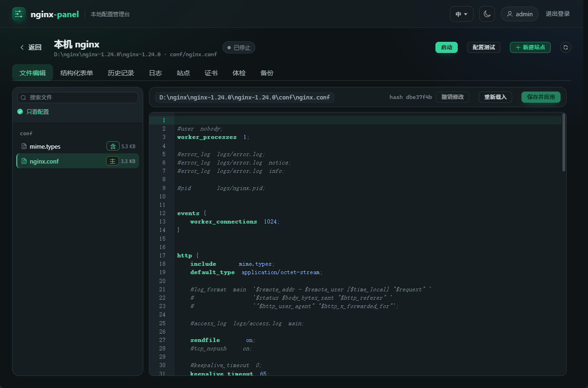
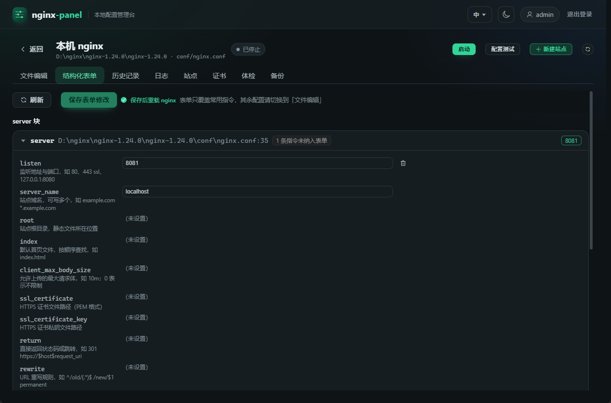
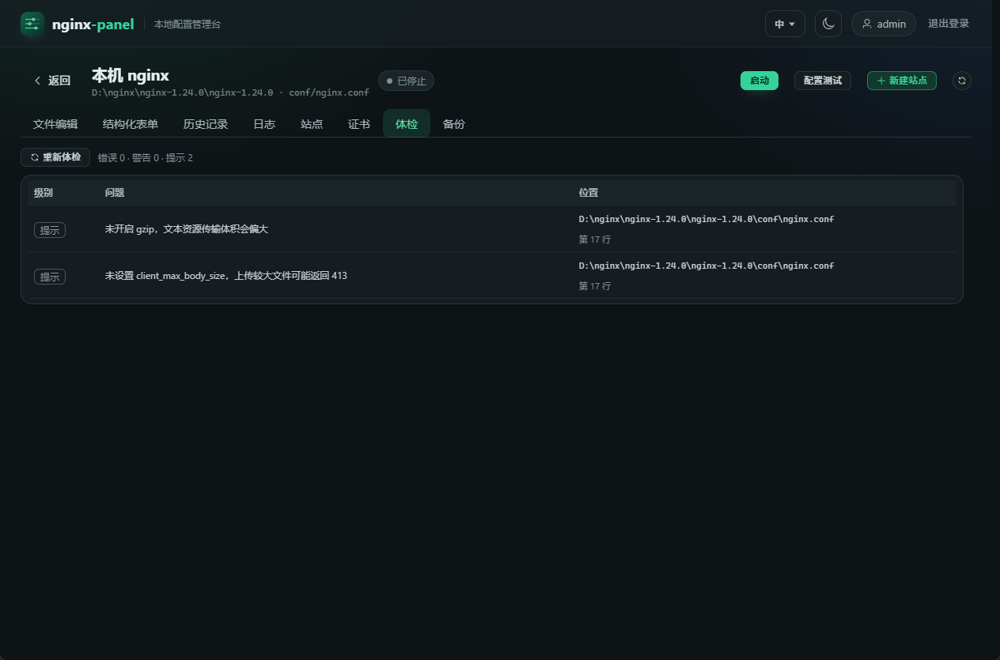

# nginx-panel

[English](README.md) | [简体中文](README.zh-CN.md)

[](https://github.com/coffin03/nginx-panel/actions/workflows/ci.yml)


本地运行的 nginx 可视化管理面板：直接接管你的 nginx 目录，在线编辑配置、一键启停重载、自动备份与回滚。数据全部保存在本地 SQLite，不需要联网，也不需要额外的云端服务。

> 如果这个项目帮你少踩了一次 nginx 配置的坑，欢迎点个 Star，让更多人发现它。

## 为什么要再做一个 nginx 面板？

nginx-panel 面向的是管理真实 `nginx.conf` 及其 `include` 树的用户，而不只是维护一组反向代理站点。

| 项目 | 适合场景 | 编辑任意配置 | 作用于运行中的 nginx |
| --- | --- | --- | --- |
| **nginx-panel** | 完整的 nginx 配置管理 + 安全生效流水线 | 支持，自动展开 `include` | 支持，校验 / 重载 / 回滚 |
| [Nginx Proxy Manager](https://github.com/NginxProxyManager/nginx-proxy-manager) | 简单易用的反向代理站点管理 | 部分（站点级片段） | 支持 |
| [NginxConfig.io](https://github.com/digitalocean/nginxconfig.io) | 生成一份新的 nginx 配置 | 只生成配置 | 不支持 |
| [nginx-ui](https://github.com/0xJacky/nginx-ui) | 通用的 nginx 管理界面 | 支持 | 支持 |

对比基于各项目公开文档整理，如有出入欢迎提 PR 修正。

## 功能

- **编辑真实配置树**：从主配置递归展开 `include`，所有被加载的文件都可直接编辑；内置语法高亮编辑器，保留缩进与注释。
- **结构化表单，最小化改动**：可视化维护常用 `server` / `location` / `upstream` 指令，只改写发生变化的片段，原文件格式与注释不受影响。
- **安全的生效流程**：快照 → 写盘 → `nginx -t` → reload → 健康检查。任一步失败自动还原，reload 后 error.log 出现新的 `[emerg]` 也会回滚。
- **新建站点与站点管理**：按域名、静态目录或反向代理生成 `conf.d` 站点，自动挂载 `include`；支持编辑、启用 / 停用与删除。
- **证书管理**：扫描配置引用的证书，展示域名、签发者与到期时间；自动探测 `certbot` / `acme.sh` 执行续期，并比对指纹确认真实更新。
- **配置体检**：基于 AST 检查重复 `server_name`、过时 TLS 协议、失效证书 / 私钥、缺失的根目录、未挂载的 `conf.d` 及常用优化项。
- **配置备份**：把主配置及其 `include` 链打包为 zip；导入前预览新增 / 覆盖 / 未变文件，确认后仍走校验、快照与失败回滚。
- **历史、日志与操作记录**：每次生效自动生成快照，可查看逐行差异并一键恢复；外部手动修改自动留档。日志支持自动刷新与关键字过滤。
- **完全本地、中英双语**：SQLite（WAL）+ bcrypt，首次启动创建管理员账号，不联网、不上报；界面与后端提示均支持中文 / English。

## 快速开始

### Windows 便携版

无需安装 Python / Node。

1. 打开 [Releases](../../releases/latest)，下载 `nginx-panel-<版本>-win64.zip`。
2. 解压后双击 `nginx-panel.exe` 运行；压缩包内含 `LICENSE.txt`。
3. 可选校验：把 `SHA256SUMS.txt` 与压缩包放在同一目录，执行
   `certutil -hashfile nginx-panel-0.1.0-win64.zip SHA256`。

程序会打开一个内嵌 WebView2 的独立桌面窗口（Windows 10/11 一般已自带；缺失时会提示并改用系统浏览器）。关闭窗口即退出程序。

当前版本：**0.1.0**，变更记录见 [CHANGELOG.md](CHANGELOG.md)。

### Docker

镜像内含 nginx，面板直接管理容器内的 nginx，适合开箱即用或作为配置预览环境：

```bash
docker run -d --name nginx-panel \
  -p 8090:8090 -p 8080:80 \
  -v nginx-panel-data:/data \
  ghcr.io/coffin03/nginx-panel:latest
```

也可以本地构建：

```bash
docker compose up -d --build
```

- 面板：<http://127.0.0.1:8090>
- 容器内 nginx：<http://127.0.0.1:8080>
- 数据卷：`nginx-panel-data` → `/data`

添加实例时填写：目录 `/etc/nginx`、可执行文件 `/usr/sbin/nginx`、主配置 `nginx.conf`、运行模式 `local`。

如果要管理自己的配置，可将 `docker-compose.yml` 中 `./nginx-conf:/etc/nginx` 的挂载取消注释，并先把配置放到 `./nginx-conf`。

### Linux（systemd）

```bash
sudo bash deploy/install.sh
```

脚本会构建前端（需要 Node.js 18+，也可预先准备好 `web/dist`）→ 安装到 `/opt/nginx-panel` → 创建虚拟环境 → 注册并启动 `nginx-panel.service`。安装完成后访问 `http://服务器IP:8090`。

首次添加实例时填写：目录 `/etc/nginx`、可执行文件 `/usr/sbin/nginx`、主配置 `nginx.conf`、运行模式 `systemd`、服务名 `nginx`。

```bash
systemctl status nginx-panel
systemctl restart nginx-panel
journalctl -u nginx-panel -f
```

### 源码运行

```bash
# 后端
python -m pip install -r server/requirements.txt
python server/run.py

# 前端（另一个终端，开发服务器会把 /api 代理到 8090）
cd web
npm install
npm run dev
```

构建 Windows 单文件 exe：

```powershell
powershell -ExecutionPolicy Bypass -File packaging\build-windows.ps1
# 产物：dist\nginx-panel.exe
```

运行测试：

```bash
python -m pytest
```

## 实例配置

添加实例时需要填写：

- **nginx 目录**：例如 `C:\nginx` 或 `/etc/nginx`
- **可执行文件**：例如 `C:\nginx\nginx.exe` 或 `/usr/sbin/nginx`
- **主配置**：Windows 为 `conf\nginx.conf`，Linux 为 `nginx.conf`
- **运行模式**：`local`（本地进程）或 `systemd`

数据文件位于 exe 同级的 `data\` 目录；如果该目录不可写，会自动落到 `%APPDATA%\nginx-panel`。

支持以下环境变量：

| 变量 | 说明 | 默认 |
| --- | --- | --- |
| `NGINX_PANEL_HOST` | 监听地址 | `127.0.0.1` |
| `NGINX_PANEL_PORT` | 监听端口 | `8090` |
| `NGINX_PANEL_DATA_DIR` | 数据目录 | exe 同级 `data` |
| `NGINX_PANEL_SECRET` | 会话签名密钥 | 自动生成并保存到 `data/secret.key` |
| `NGINX_PANEL_BROWSER` | 设为 `1` 时改用系统浏览器打开 | 未设置 |
| `NGINX_PANEL_NO_BROWSER` | 设为 `1` 时只启动后台服务，不打开窗口 | 未设置 |

启动日志写在数据目录的 `logs\app.log`。

## 工作方式

- **解析而不是正则替换**：自研 nginx 配置解析器为每条指令记录文件、偏移、行号；编辑时只替换最小文本区间，不重新序列化整个文件，因此缩进、对齐和注释都能保留。
- **include 展开**：从主配置递归展开 `include`（支持相对路径与通配符），所有被包含的文件都可以直接编辑。
- **冲突保护**：保存时携带文件内容哈希，磁盘内容被其他程序改过会返回 409，避免覆盖他人修改。
- **失败即回滚**：写盘前先备份，`nginx -t` 失败立即还原；reload 后进程消失或 error.log 出现新的 `[emerg]` 会再次回滚。
- **外部修改留档**：后台监听配置目录，检测到非本面板的修改会自动生成 `auto` 快照。

## 截图

<p align="center">
  
</p>
<p align="center">
  
  
</p>

首个公开版本会补充一段 30 秒演示（改配置 → `nginx -t` 失败 → 自动回滚）。

## 目录结构

```
server/          FastAPI 后端：nginx 解析器、include 展开、生效流水线、REST 接口
web/             Vue 3 + Element Plus + CodeMirror 6 前端
packaging/       PyInstaller 打包配置与发布脚本
deploy/          Linux 安装脚本与 systemd unit
.github/         CI 与 Release 工作流
tests/           解析器与接口测试
```

## 安全说明

- 面板默认只监听 `127.0.0.1`。如需对外开放，请放在带 HTTPS 的反向代理之后，并设置强密码。
- Linux 安装脚本使用 root 运行面板（需要写 nginx 配置并调用 systemctl）；请把服务器访问权限控制在可信范围内。
- 所有数据（账号、快照、密钥）都在本地，不会上传到任何地方。

## 参与贡献

欢迎提 Issue 与 PR：先在 [Issues](../../issues) 说明场景或复现步骤，PR 请保持改动聚焦，并确保 `python -m pytest` 与 `npm run build` 通过。版本变更记录见 [CHANGELOG.md](CHANGELOG.md)。

## License

[MIT](LICENSE)